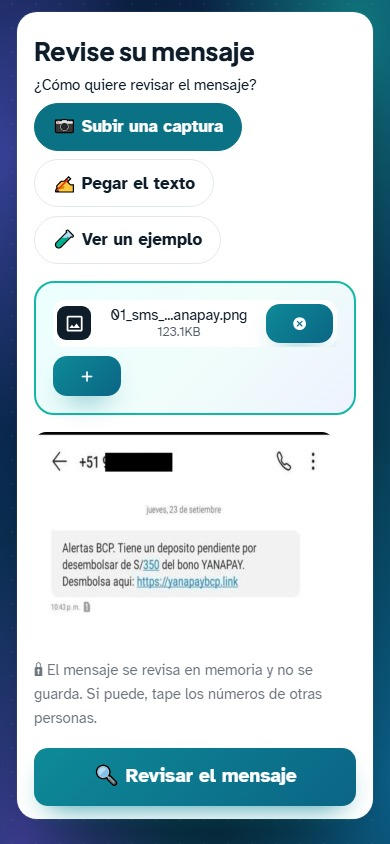
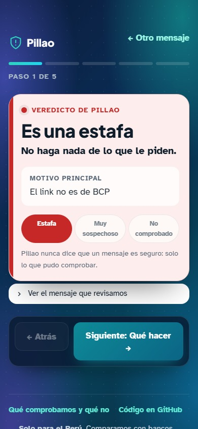
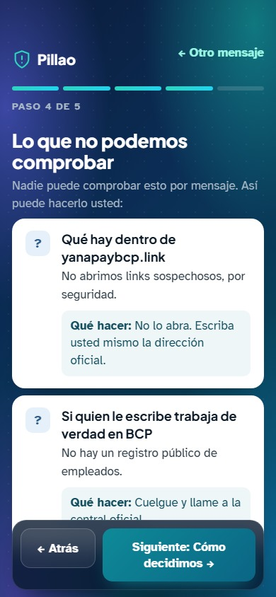
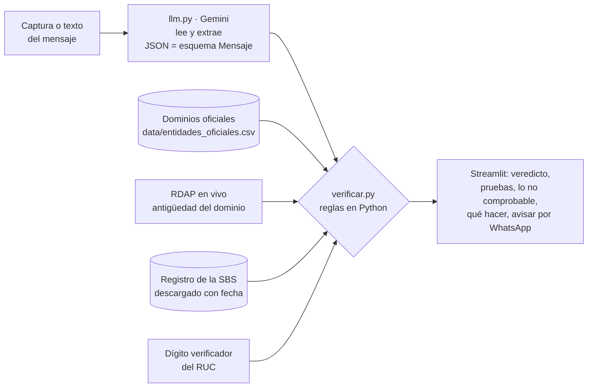

# 🛡️ Pillao

> **Las personas mayores nos mandan la captura de un mensaje sospechoso y en segundos les decimos si es estafa, con la prueba concreta, y qué no se puede comprobar y cómo hacerlo ellas mismas.**

**Demo:** [pillao.streamlit.app](https://pillao.streamlit.app) · **Video de respaldo (1:19):** [docs/demo.mp4](docs/demo.mp4) · Proyecto final de la Diplomatura de Ciencia de Datos para las Ciencias Sociales y la Gestión Pública (Q-Lab PUCP, 2026).

---

## 1. One-liner

Protegemos a las personas mayores de las estafas por WhatsApp y SMS mediante IA que lee la captura del mensaje y reglas que comprueban cada dato (link, RUC, entidad, lo que le piden) contra fuentes públicas.

## 2. Founder


**Cristian Moisés Wong Pagan.** Politólogo de la UNMSM (primer puesto de su promoción) y bachiller en Ingeniería Geográfica, con formación en gobernabilidad e innovación pública (PUCP-CAF) y en ciencia de datos. **Por qué yo:** a mis padres les llegan estos mensajes cada semana y yo soy quien les responde. Desde la gestión pública sé que el problema se puede frenar con datos que ya existen; Pillao los pone al alcance de cualquiera, en segundos.

Cómo cubro cada rol con agentes de IA:

| Rol | Cómo lo cubro |
|---|---|
| Producto | Yo: elegí el problema, hablé con personas mayores y con sus hijos, y definí qué se puede comprobar y qué no ([`docs/alcance.md`](docs/alcance.md)). |
| Ingeniería | Claude Code como co-founder técnico (ver la sección 9). |
| Diseño | Streamlit con letra grande, un solo veredicto y los links del mensaje desactivados. Claude Code propone, yo decido. |
| Ventas | ✏️ Primeros usuarios: familias de mi entorno; luego cajas municipales y cooperativas. |

<br clear="left">

## 3. Problema

**Quién lo sufre:** madres y padres de 65 a 75 años de Lima que reciben de 3 a 6 mensajes o llamadas sospechosas al mes por SMS, WhatsApp o teléfono. Usen o no Yape, les llegan igual. Y sus hijos adultos, que terminan de «verificadores» de la familia.

**Qué les cuesta:**
- **A la persona mayor:** de 10 a 20 minutos de incertidumbre y susto por cada mensaje dudoso, hasta que consigue a alguien que lo revise.
- **Al hijo:** 5 o 6 interrupciones al mes en el trabajo y la «carga mental» de vigilar.
- **Cuando caen:** dinero. En el entorno de los entrevistados hubo pérdidas de **S/ 500** (enlace de un falso bono del Estado) y **S/ 1,200** (voucher de depósito falso), según lo que les contaron.

**Cómo lo resuelven hoy:** le preguntan a un hijo, que fue lo que hicieron las tres personas entrevistadas. Le llevan el celular, le mandan un pantallazo por WhatsApp, o cortan la llamada y lo llaman a su número. Si el hijo no contesta, esperan con la duda o deciden solos y con prisa, que es justo lo que busca el estafador. Los trucos que usan («desconfío de los números raros», «el tono de voz») fallan cuando «las letras y los logos se ven tan iguales».

**Evidencia:** notas de 3 conversaciones del 10 de noviembre en [`docs/research/`](docs/research/): una mujer de 68 años que usa Yape, un hombre de 72 que no usa pagos digitales y un hijo de 35 cuyos padres le consultan 5 o 6 veces al mes. El hijo pagaría el plan Familia: *«Pucha, recontra pagaría. S/ 9 al mes es baratísimo con la tranquilidad de saber que mis viejos no van a caer en una estafa»*. Son tres personas de Lima del entorno del founder: sirven para entender el problema, pero no son una muestra representativa.

## 4. Solución e insight

Pillao recibe una captura de pantalla o el texto del mensaje y devuelve:

1. **Un veredicto en grande:** 🔴 es una estafa · 🟠 muy sospechoso · 🟡 no pudimos comprobarlo. **Nunca dice «es seguro».**
2. **Lo que comprobamos**, cada cosa con su fuente: el link no es del banco que dice ser, el RUC es inventado, la web se creó hace 4 días, le piden el código SMS.
3. **Lo que no podemos comprobar y cómo hacerlo usted:** de quién es el número de Yape (secreto bancario), si el voucher es real, si su hijo de verdad cambió de número.
4. **Qué hacer ahora**, en 3 o 4 pasos, y un botón para **avisar a la familia por WhatsApp**.

**Modalidades que reconoce:** SMS falsos de bancos y cajas con links imitadores · «Mamá, este es mi número nuevo» · préstamos sin Infocorp con cobro adelantado · paquetes «retenidos» · el código de WhatsApp «enviado por error» (robo de cuenta) · trabajos por dar «me gusta» o reseñas («estafa de las tareas») · «le yapeé por error, devuélvamelo» · vouchers de **Yape falso** · páginas falsas de Yape que piden clave o tarjeta.

**Insight:** la IA no debe *opinar* si algo es estafa; debe *leer*. Lo que convence a una persona mayor, y a su hijo, es una prueba concreta («este link no es del BCP») y la honestidad sobre lo que nadie puede saber. Por eso en Pillao **la IA solo lee y extrae; el veredicto lo deciden reglas auditables en Python.** Además, los estafadores usan nombres de entidades reales: por eso comprobamos el *canal* (el link, el número, lo que piden), no el nombre.

El detalle campo por campo está en [`docs/alcance.md`](docs/alcance.md).

## 5. Why now

- Los modelos multimodales leen una captura de WhatsApp, con emojis y números cortados, y devuelven sus datos en JSON por una fracción de centavo. Hace tres años hacía falta un OCR y reglas distintas para cada aplicación.
- Las salidas estructuradas permiten separar *leer* (IA) de *decidir* (reglas), así que el veredicto se puede explicar y probar.
- Los pagos por Yape y Plin llegaron a las personas mayores, y con ellos las estafas por mensaje. ✏️ *Agregar una cifra con fuente (SBS, PNP o Indecopi).*

## 6. Demo

**URL:** [https://pillao.streamlit.app](https://pillao.streamlit.app) (Streamlit Community Cloud).

**Cómo correrlo en local** (Windows, macOS o Linux con [uv](https://docs.astral.sh/uv/)):

```bash
git clone https://github.com/Cris92W/Proyecto_final_Construye-tu-startup && cd Proyecto_final_Construye-tu-startup
cp .env.example .env          # y pega tu clave de https://aistudio.google.com/apikey
uv sync
uv run streamlit run app/streamlit_app.py
uv run pytest                 # pruebas sin red ni LLM
```

**Capturas del flujo principal** (app publicada, en el celular, con un SMS real que publicó la prensa y el número tapado):

| 1. Suba la captura | 2. El veredicto, con la prueba | 3. Lo que no se puede comprobar |
|:---:|:---:|:---:|
|  |  |  |

El resultado es un carrusel de cinco pantallas (veredicto, qué hacer, pruebas, lo que no se puede comprobar y cómo decidimos): se avanza con los botones, deslizando con el dedo o con las flechas del teclado.

**Video de respaldo:** [docs/demo.mp4](docs/demo.mp4) (1:19, con subtítulos). Lo narra mi voz clonada con **Qwen3-TTS** (modelo abierto, como en la sesión 15) a partir de una muestra de 17 segundos de mi voz, con música de fondo original. Mientras no hay voz (subir la captura, esperar a Gemini), la pantalla va adelantada ×3 y el video lo indica. Dos casos reales de principio a fin en la app publicada: un SMS falso del «bono Yanapay» (🔴 es una estafa) y un voucher falso de Yape (🟡 no se puede comprobar, y cómo hacerlo uno mismo).

**Arquitectura:**



**Modelo y por qué:** `gemini-3.5-flash-lite`, con `gemini-3.5-flash` de respaldo si el primero está saturado. Lee imágenes, respeta un esquema JSON y hace **una sola llamada** por revisión; las comprobaciones (dominios, RUC, RDAP) no cuestan. Lo elegimos midiendo con 14 capturas reales de estafas publicadas por medios peruanos (2026-11-10):

| Modelo | Tiempo por captura | Resultado | Plan gratuito |
|---|---|---|---|
| `gemini-3.5-flash-lite` | 2 a 5 s | 13 de 14 en 🔴 o 🟠; el voucher falso de Yape en 🟡 «no se puede comprobar», como debe ser. Ninguna pasó como segura. | ~500 consultas al día |
| `gemini-3.5-flash` | 10 a 41 s | Los mismos veredictos en las 10 que alcanzó a revisar | 20 consultas al día (se agotó en la prueba) |

Para una persona mayor que espera frente al celular, 3 segundos contra 30 es la diferencia entre usarlo o no. (`gemini-2.5-flash` ya no está disponible para cuentas nuevas.)

**Privacidad:** la captura se procesa en memoria y no se guarda. Las capturas del demo tienen los números de otras personas tapados. El plan gratuito de Gemini puede usar los datos para mejorar el servicio: en producción se usaría el plan de pago, cuyos datos no se usan para entrenar modelos.

## 7. Modelo de negocio

**Quién paga:** los hijos que quieren proteger a sus padres (plan Familia) y, después, las cajas, cooperativas y fintechs, a las que cada estafa les cuesta reclamos, devoluciones y confianza.

| Plan | Precio | Incluye |
|---|---|---|
| Gratis | S/ 0 | 5 revisiones al mes |
| Familia | S/ 9 al mes | Hasta 5 celulares, revisiones ilimitadas y aviso al hijo o hija cuando el veredicto es 🔴 |
| Entidades | S/ 2,500 al mes | Marca blanca para cajas y cooperativas, y panel de las modalidades de estafa que reciben sus clientes |

**Costo por usuario (margen de contribución):** medido con tokens reales, una revisión usa unos 2,100 tokens de entrada y 250 de salida: **US$ 0.0012 (S/ 0.004)** al precio de lista de `gemini-3.5-flash-lite` (US$ 0.30 y 2.50 por millón de tokens, según rastreadores de precios; confirmar en [ai.google.dev/pricing](https://ai.google.dev/gemini-api/docs/pricing)). Las comprobaciones no cuestan.

| Plan Familia (S/ 9 al mes) | Revisiones al mes | Costo de IA | Margen de contribución |
|---|---|---|---|
| Uso normal (5 celulares) | 100 | S/ 0.44 | 95 % |
| Uso intenso | 500 | S/ 2.20 | 76 % |

El servidor del demo es gratis (Streamlit Community Cloud); en producción, un servidor compartido para miles de familias costaría unos centavos por familia. La app muestra el costo real de cada revisión en «Cuánto costó esta revisión».

## 8. Herramientas del curso

| Herramienta | Sesión | Para qué la usa el cliente | Dónde está |
|---|---|---|---|
| Document AI (lectura de imágenes con un modelo de visión) | 10 | Lee la captura de WhatsApp o SMS, con sus links y números | [`app/pillao/llm.py`](app/pillao/llm.py), [`ai/prompts/leer_mensaje.md`](ai/prompts/leer_mensaje.md) |
| LLMs con salidas estructuradas | 08 | Convierte el mensaje en campos con citas textuales que las reglas pueden comprobar | [`app/pillao/esquemas.py`](app/pillao/esquemas.py) |
| APIs | 03 | Consulta en vivo la antigüedad del dominio (RDAP) | [`app/pillao/verificar.py`](app/pillao/verificar.py) |

Por qué estas: sin Document AI la persona mayor tendría que copiar el texto a mano; sin salidas estructuradas no habría campos que comprobar, solo una opinión del modelo; sin la API, un link recién creado se vería igual que uno de hace años.

## 9. Qué hizo el agente

Este repo se construyó con **Claude Code** (modelo Claude Opus 5.5) como co-founder técnico:

- **El agente:** propuso la idea entre varias, comprobó qué fuentes de datos responden de verdad (RDAP sí; la web de la SBS bloquea consultas automáticas; NIC.pe no tiene RDAP), escribió las reglas de verificación, el esquema, el prompt, la app, las pruebas y el borrador de este README. También rediseñó la interfaz y **grabó el video de respaldo**: manejó Chrome en tamaño de celular sobre la app publicada (subió las capturas, pulsó y deslizó como una persona) y montó los subtítulos con Pillow y ffmpeg. Narró el guion con la voz clonada del founder (Qwen3-TTS en CPU, cada frase revisada con Whisper y generada de nuevo si no se entendía) y compuso la música de fondo con NumPy, así que no tiene derechos de terceros. Los veredictos del video son los que dio la app en vivo.
- **El founder:** eligió el problema y el público (personas mayores), pidió separar lo que se puede comprobar de lo que no, hizo las entrevistas, aportó capturas reales, pidió el carrusel de una pantalla por paso, el fondo en degradado, resaltar dónde se sube la captura y aclarar que es solo para el Perú, y aprobó el guion del video.

## Estructura

```
app/streamlit_app.py   interfaz
app/pillao/            esquemas, llm (lectura), verificar (reglas y veredicto)
ai/prompts/            prompt de lectura del mensaje
data/                  dominios oficiales y, con fecha, el registro de la SBS
docs/                  alcance.md, capturas, foto y research/ con las 3 conversaciones
tests/                 pruebas sin red ni LLM
```

Licencia [MIT](LICENSE).
