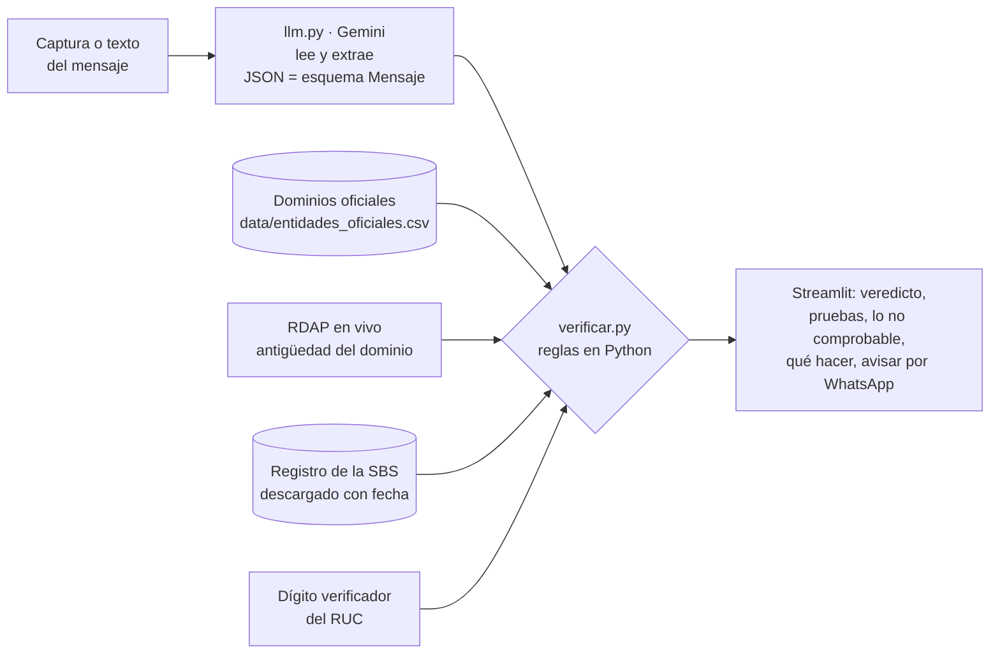

# 🛡️ Pillao

> **Las personas mayores nos mandan la captura de un mensaje sospechoso y en segundos les decimos si es estafa, con la prueba concreta, y qué no se puede comprobar y cómo hacerlo ellas mismas.**

**Demo:** ✏️ URL de Streamlit Cloud (pendiente) · **Video de respaldo:** ✏️ (pendiente) · Proyecto final de la Diplomatura de Ciencia de Datos para las Ciencias Sociales y la Gestión Pública (Q-Lab PUCP, 2026).

---

## 1. One-liner

Protegemos a las personas mayores de las estafas por WhatsApp y SMS mediante IA que lee la captura del mensaje y reglas que comprueban cada dato (link, RUC, entidad, lo que le piden) contra fuentes públicas.

## 2. Founder


**Cristian Moisés Wong Pagan.** Politólogo egresado de la UNMSM (primer puesto de su promoción) y bachiller en Ingeniería Geográfica. ✏️ *Una línea sobre por qué tú: p. ej., «A mi mamá le llegó un "hijo con número nuevo" pidiendo S/ 500 y me llamó a preguntar. Pillao es esa llamada, disponible a cualquier hora».*

Cómo cubro cada rol con agentes de IA:

| Rol | Cómo lo cubro |
|---|---|
| Producto | Yo: elegí el problema, hablé con personas mayores y con sus hijos, y definí qué se puede comprobar y qué no ([`docs/alcance.md`](docs/alcance.md)). |
| Ingeniería | Claude Code como co-founder técnico (ver la sección 9). |
| Diseño | Streamlit con letra grande, un solo veredicto y los links del mensaje desactivados. Claude Code propone, yo decido. |
| Ventas | ✏️ Primeros usuarios: familias de mi entorno; luego cajas municipales y cooperativas. |

<br clear="left">

## 3. Problema

**Quién lo sufre:** personas mayores que usan WhatsApp y Yape, y sus hijos, que reciben la llamada de «¿esto es verdad?». ✏️ *Precisar con las entrevistas (p. ej., «madres y padres de 60 a 75 años de Lima que usan Yape»).*

**Qué les cuesta:** ✏️ *de las entrevistas: cuánto perdieron, cuántas veces al mes preguntan a sus hijos, cuánto tardan en resolver la duda.*

**Cómo lo resuelven hoy:** llaman a un hijo o nieto (si contesta), preguntan en el grupo de la familia, o deciden solos y con prisa, que es justo lo que busca el estafador. ✏️ *Confirmar con las entrevistas.*

**Evidencia:** notas de 3 conversaciones en [`docs/research/`](docs/research/). ✏️

## 4. Solución e insight

Pillao recibe una captura de pantalla o el texto del mensaje y devuelve:

1. **Un veredicto en grande:** 🔴 es una estafa · 🟠 muy sospechoso · 🟡 no pudimos comprobarlo. **Nunca dice «es seguro».**
2. **Lo que comprobamos**, cada cosa con su fuente: el link no es del banco que dice ser, el RUC es inventado, la web se creó hace 4 días, le piden el código SMS.
3. **Lo que no podemos comprobar y cómo hacerlo usted:** de quién es el número de Yape (secreto bancario), si el voucher es real, si su hijo de verdad cambió de número.
4. **Qué hacer ahora**, en 3 o 4 pasos, y un botón para **avisar a la familia por WhatsApp**.

**Insight:** la IA no debe *opinar* si algo es estafa; debe *leer*. Lo que convence a una persona mayor, y a su hijo, es una prueba concreta («este link no es del BCP») y la honestidad sobre lo que nadie puede saber. Por eso en Pillao **la IA solo lee y extrae; el veredicto lo deciden reglas auditables en Python.** Además, los estafadores usan nombres de entidades reales: por eso comprobamos el *canal* (el link, el número, lo que piden), no el nombre.

El detalle campo por campo está en [`docs/alcance.md`](docs/alcance.md).

## 5. Why now

- Los modelos multimodales leen una captura de WhatsApp, con emojis y números cortados, y devuelven sus datos en JSON por una fracción de centavo. Hace tres años hacía falta un OCR y reglas distintas para cada aplicación.
- Las salidas estructuradas permiten separar *leer* (IA) de *decidir* (reglas), así que el veredicto se puede explicar y probar.
- Los pagos por Yape y Plin llegaron a las personas mayores, y con ellos las estafas por mensaje. ✏️ *Agregar una cifra con fuente (SBS, PNP o Indecopi).*

## 6. Demo

**URL:** ✏️ pendiente (Streamlit Community Cloud).

**Cómo correrlo en local** (Windows, macOS o Linux con [uv](https://docs.astral.sh/uv/)):

```bash
git clone https://github.com/Cris92W/Proyecto_final_Construye-tu-startup && cd Proyecto_final_Construye-tu-startup
cp .env.example .env          # y pega tu clave de https://aistudio.google.com/apikey
uv sync
uv run streamlit run app/streamlit_app.py
uv run pytest                 # pruebas sin red ni LLM
```

**Capturas del flujo principal:** ✏️ `docs/capturas/1_captura.png`, `2_veredicto.png`, `3_no_comprobable.png`.

**Arquitectura:**



**Modelo y por qué:** `gemini-2.5-flash`, porque lee imágenes, respeta un esquema JSON y su plan gratuito alcanza para el demo. Hace **una sola llamada** por revisión; las comprobaciones (dominios, RUC, RDAP) no cuestan.

**Privacidad:** la captura se procesa en memoria y no se guarda. Las capturas del demo tienen los números de otras personas tapados. El plan gratuito de Gemini puede usar los datos para mejorar el servicio: en producción se usaría el plan de pago, cuyos datos no se usan para entrenar modelos.

## 7. Modelo de negocio

**Quién paga:** los hijos que quieren proteger a sus padres (plan Familia) y, después, las cajas, cooperativas y fintechs, a las que cada estafa les cuesta reclamos, devoluciones y confianza.

| Plan | Precio | Incluye |
|---|---|---|
| Gratis | S/ 0 | 5 revisiones al mes |
| Familia | S/ 9 al mes | Hasta 5 celulares, revisiones ilimitadas y aviso al hijo o hija cuando el veredicto es 🔴 |
| Entidades | S/ 2,500 al mes | Marca blanca para cajas y cooperativas, y panel de las modalidades de estafa que reciben sus clientes |

**Costo por usuario (margen de contribución):** ✏️ se completa con lo que mide la app en «Cuánto costó esta revisión» (tokens reales × precio de lista del modelo).

## 8. Herramientas del curso

| Herramienta | Sesión | Para qué la usa el cliente | Dónde está |
|---|---|---|---|
| Document AI (lectura de imágenes con un modelo de visión) | 10 | Lee la captura de WhatsApp o SMS, con sus links y números | [`app/pillao/llm.py`](app/pillao/llm.py), [`ai/prompts/leer_mensaje.md`](ai/prompts/leer_mensaje.md) |
| LLMs con salidas estructuradas | 08 | Convierte el mensaje en campos con citas textuales que las reglas pueden comprobar | [`app/pillao/esquemas.py`](app/pillao/esquemas.py) |
| APIs | 03 | Consulta en vivo la antigüedad del dominio (RDAP) | [`app/pillao/verificar.py`](app/pillao/verificar.py) |

Por qué estas: sin Document AI la persona mayor tendría que copiar el texto a mano; sin salidas estructuradas no habría campos que comprobar, solo una opinión del modelo; sin la API, un link recién creado se vería igual que uno de hace años.

## 9. Qué hizo el agente

Este repo se construyó con **Claude Code** (modelo Claude Opus 5.5) como co-founder técnico:

- **El agente:** propuso la idea entre varias, comprobó qué fuentes de datos responden de verdad (RDAP sí; la web de la SBS bloquea consultas automáticas; NIC.pe no tiene RDAP), escribió las reglas de verificación, el esquema, el prompt, la app, las pruebas y el borrador de este README.
- **El founder:** eligió el problema y el público (personas mayores), pidió separar lo que se puede comprobar de lo que no, hizo las entrevistas, aportó capturas reales y ✏️ *(completar)*.

## Estructura

```
app/streamlit_app.py   interfaz
app/pillao/            esquemas, llm (lectura), verificar (reglas y veredicto)
ai/prompts/            prompt de lectura del mensaje
data/                  dominios oficiales y, con fecha, el registro de la SBS
docs/                  alcance.md, capturas, foto y research/ con las 3 conversaciones
tests/                 pruebas sin red ni LLM
```

Licencia [MIT](LICENSE).
